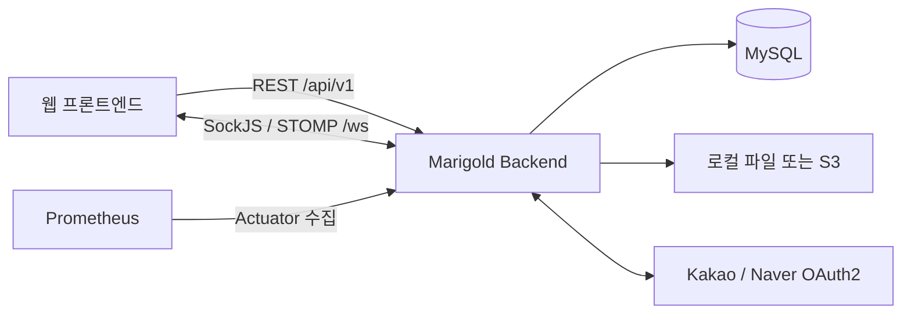
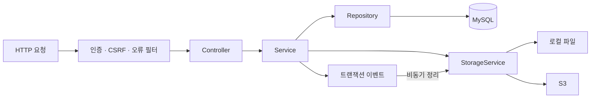
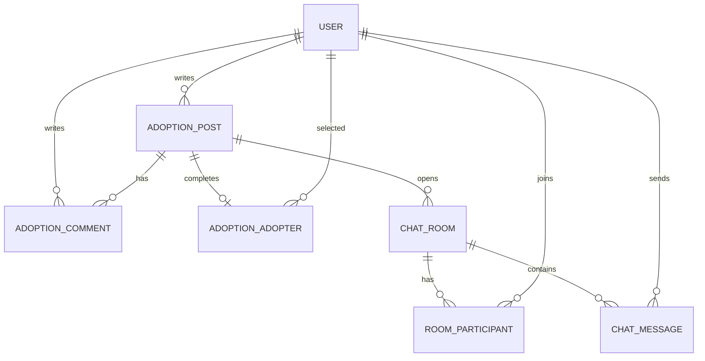

# 아키텍처

## 전체 구조

Marigold 백엔드는 하나의 Gradle 프로젝트와 하나의 Spring Boot 프로세스로 배포되는 모놀리스입니다. 코드는 기능별 패키지로 나뉘지만 패키지 간 직접 참조가 있으므로, 독립 배포 모듈이나 단방향 의존 구조로 보지 않습니다.

## 패키지 책임

- `auth`: 로컬 로그인과 가입, OAuth2, JWT, refresh·CSRF·recent-auth 쿠키
- `user`: 사용자, 프로필 이미지, 자격 증명 연결과 계정 관리
- `adoption`: 입양 게시글, 이미지, 댓글과 답글, 입양자 확정
- `chat`: 게시글 기반 채팅방, 참여자, 메시지와 첨부파일
- `storage`: 공통 저장 계약과 로컬 파일시스템/S3 구현
- `global`: 공통 설정, 검증 정책, 오류 응답과 TSID 변환
- `audit`: 인증, 권한, 삭제 등 주요 행위의 감사 로그

일반적인 HTTP 요청은 `Controller → Service → Repository → MySQL` 순서로 처리됩니다. 기능 서비스는 필요한 다른 기능의 서비스나 저장소를 직접 호출합니다. 특히 `user`, `adoption`, `chat` 사이에는 양방향 참조가 있으므로 변경 시 연관 기능을 함께 확인해야 합니다.

## 핵심 데이터 관계

- 게시글은 작성자, 이미지, 댓글을 가지며 댓글은 답글을 가질 수 있습니다.
- 입양 완료 시 게시글 하나에 선택된 입양자 한 명이 연결됩니다.
- 채팅방은 입양 게시글에 속합니다. 서비스가 방 생성 시 두 사용자를 참여자로 구성하지만 DB 관계 자체가 참여자 수를 강제하지는 않습니다.
- 파일 본문은 로컬 파일시스템이나 S3에 저장하고, DB에는 저장 파일명과 원본 파일명 등의 메타데이터를 보관합니다.

## 대표 흐름

### 입양 완료

게시글 작성자가 채팅 참여자 중 입양자를 선택하면 게시글 상태와 입양자 관계를 한 트랜잭션에서 저장합니다. 완료 취소 시 관계를 제거하고 게시글 상태를 되돌립니다.

### 채팅

REST API가 채팅방 생성·조회, 메시지 이력과 첨부파일을 담당합니다. 실시간 텍스트 메시지는 STOMP로 저장한 뒤 해당 방 구독자에게 발행합니다. 연결과 구독 단계에서 인증 및 방 참여 여부를 검증합니다.

### 파일 정합성

서비스는 파일을 먼저 저장하고 DB 트랜잭션을 수행합니다. 트랜잭션이 롤백되면 새 파일을 삭제하고, 커밋되면 교체된 이전 파일을 비동기로 정리합니다.

인터페이스별 인증과 오류 계약은 [인터페이스 문서](interfaces.md), 실행 환경은 [운영 문서](operations.md)를 참고합니다.
