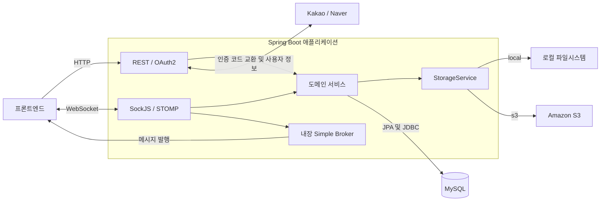
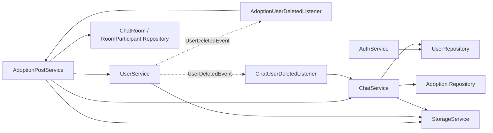
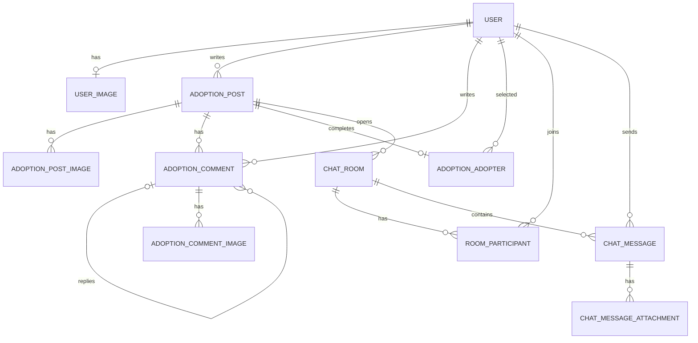
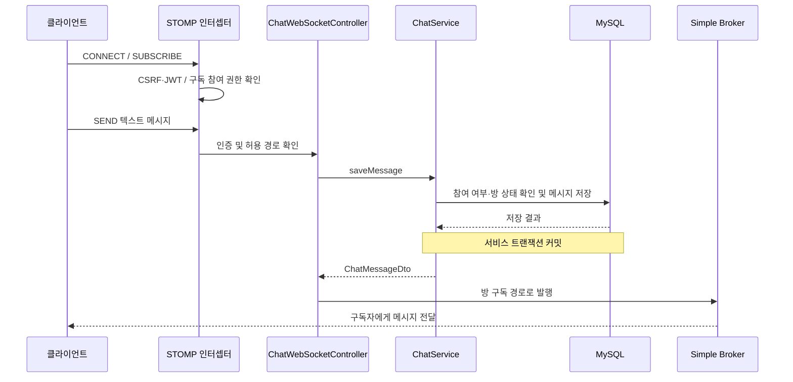

# 아키텍처

이 문서는 처음 참여하는 백엔드 개발자가 시스템 경계, 코드 책임, 데이터 흐름과 현재 구현의 제약을 파악하기 위한 안내입니다. 코드와 설정을 기준으로 설명하며, API 상세
계약은 [인터페이스](interfaces.md), 실행·배포 절차와 운영 상태는 [실행과 운영](operations.md)을 참고합니다.

## 시스템 개요

백엔드는 Java 17과 Spring Boot를 사용하는 단일 Gradle 애플리케이션입니다. 인증, 사용자, 입양 게시글과 채팅 기능이 같은 프로세스에서 실행되고 MySQL을
공유합니다. 기술 의존성의 정확한 버전은 [build.gradle.kts](../build.gradle.kts)를 기준으로 합니다.

REST는 데이터 조회·변경과 파일 업로드를, STOMP는 실시간 텍스트 메시지 송수신을 담당합니다. 파일 본문은 저장소에 두고 DB에는 저장 파일명, 원본 파일명 등의
메타데이터를 보관합니다.

저장소 구현은 `app.storage.type`으로 선택합니다. 저장소에 포함된 `local` 프로필은 로컬 파일시스템을, `prod` 프로필은 S3를 사용합니다. 위 그림은
코드의 연결 구조이며 실제 서비스의 가동 상태를 의미하지 않습니다.

## 코드 구조

### 패키지 책임

- `auth`: 로컬 로그인과 가입, OAuth2, JWT, refresh·CSRF·recent-auth 쿠키
- `user`: 사용자, 프로필 이미지, 자격 증명 연결과 계정 관리
- `adoption`: 입양 게시글, 이미지, 댓글과 답글, 입양자 확정
- `chat`: 게시글 기반 채팅방, 참여자, 메시지와 첨부파일
- `storage`: 공통 저장 계약, 로컬 파일시스템/S3 구현, 트랜잭션 이후 파일 삭제와 고아 파일 정리
- `global`: 공통 설정, 검증 정책, 오류 응답과 TSID 변환
- `audit`: 인증, 권한, 삭제 등 주요 행위의 감사 로그

기준 경로는 [`com.sns.marigold`](../src/main/java/com/sns/marigold)입니다. 도메인별 패키지 안에 `controller`,
`service`, `repository`, `entity`, `dto` 등을 배치합니다.

### 계층과 의존 관계

일반적인 요청은 보안 필터, Controller, Service, Repository 순서로 처리합니다. Controller는 요청 바인딩·검증과 응답을, Service는
권한·업무 규칙과 트랜잭션을, Repository는 데이터 접근을 담당합니다. Entity에는 상태 변경과 이미지 개수 같은 객체 규칙도 있습니다.

패키지 간에는 다른 도메인의 Service뿐 아니라 Repository와 Entity를 직접 참조하는 관계가 있습니다. 다음은 주요 의존 관계이며 전체 클래스 의존도는 아닙니다.

예를 들어 게시글 삭제는 댓글 정리와 채팅방 종료를 함께 수행하고, 회원 탈퇴는 작성 게시글과 참여 채팅방에도 영향을 줍니다. 따라서 한 도메인의 변경을 검토할 때 호출하는 다른
도메인의 트랜잭션과 조회 조건도 확인해야 합니다.

회원 탈퇴는 `user`가 다른 도메인을 직접 호출하지 않고 `UserDeletedEvent`를 발행합니다. 각 도메인의 리스너는 동기 `@EventListener`로 탈퇴 트랜잭션
안에서 실행되므로 하나라도 실패하면 탈퇴 전체가 롤백됩니다. 탈퇴 시 정리할 도메인이 늘어나면 해당 도메인에 리스너를 추가합니다. 실패해도 되는 부수 효과(스토리지 삭제
등)만 `AFTER_COMMIT` 비동기 리스너로 처리합니다.

근거: [AdoptionPostService](../src/main/java/com/sns/marigold/adoption/service/AdoptionPostService.java), [UserService](../src/main/java/com/sns/marigold/user/service/UserService.java), [ChatService](../src/main/java/com/sns/marigold/chat/service/ChatService.java).

## 핵심 데이터 모델

아래 이름은 엔티티 관계를 표현한 논리 이름입니다. 실제 테이블·컬럼명은 각 Entity의 JPA 매핑을 기준으로 합니다.

- 게시글은 작성자와 연결되고 이미지·댓글을 가집니다. 댓글은 선택적으로 부모 댓글을 참조하며, 댓글 생성 시 부모가 같은 게시글에 속하는지 검사합니다.
- `AdoptionAdopter`의 `adoption_post_id`에는 유일 제약을 선언합니다. 게시글별 입양자는 최대 한 명이며, 완료 상태와 입양자 관계를 함께 변경하는
  규칙은 Service가 담당합니다.
- `RoomParticipant`의 `(chat_room_id, user_id)`에는 유일 제약을 선언합니다. 서비스는 방을 만들 때 두 사용자를 등록하고 응답 변환 시 참여자
  수가 2명인지 확인하지만, DB 관계 자체가 2명을 강제하지는 않습니다.
- 참여자의 나가기는 행 삭제 대신 `leavedAt`을 기록하고, 재참여 시 이를 지웁니다. 방 종료 상태 `CLOSED`와 개별 사용자의 나가기 상태는 별개입니다.
- 게시글 삭제는 `deletedAt`을 기록하는 논리 삭제입니다. 관련 댓글 정리, 채팅방 종료와 파일 삭제 이벤트가 함께 수행되며, 모든 연관 데이터의 물리 삭제를 뜻하지
  않습니다.

- `AdoptionPost`와 `AdoptionComment`는 `version` 컬럼으로 낙관적 락을 사용합니다. 동시 수정으로 나중 커밋이 실패하면 `409 CONCURRENT_MODIFICATION`을
  반환합니다. JPQL bulk update는 `version`을 올리지 않습니다.

유일 제약과 `version` 컬럼은 소스의 선언 기준입니다. `prod`의 `ddl-auto=none`에서는 실제 DB에 적용되었는지 스키마 관리 과정에서 확인해야 합니다.
(`version`: `ALTER TABLE adoption_post ADD COLUMN version BIGINT NOT NULL DEFAULT 0;`, `adoption_comment`도 동일)

근거: [AdoptionAdopter](../src/main/java/com/sns/marigold/adoption/entity/AdoptionAdopter.java), [RoomParticipant](../src/main/java/com/sns/marigold/chat/entity/RoomParticipant.java), [AdoptionCommentService](../src/main/java/com/sns/marigold/adoption/service/AdoptionCommentService.java).

## 주요 처리 흐름

### 인증과 권한 검사

OAuth2 요청은 우선순위 1의 `OAuth2SecurityConfig`, 일반 요청은 우선순위 2의 `CommonSecurityConfig`가 처리합니다. 두 체인 모두
HTTP 세션 기반 인증을 사용하지 않습니다.

1. 로컬 로그인은 사용자 조회, 비밀번호와 사용자 상태 확인 후 access·refresh token을 발급합니다. Access token은 본문으로 반환하고
   refresh·CSRF·최근 인증 정보는 쿠키로 발급합니다.
2. 일반 REST 요청은 커스텀 CSRF 필터와 JWT 인증 필터를 거칩니다. JWT 검증 결과로 `CustomPrincipal`을 만들고, Controller의
   `@PreAuthorize`와 Service의 소유자·참여자 검사로 접근을 제한합니다. 일반 보안 체인의 URL 규칙 자체는 `permitAll`이므로 새 API의 권한은
   명시적으로 설정해야 합니다.
3. Refresh 요청은 refresh token을 검증하고 DB에서 현재 사용자 상태와 권한을 다시 읽은 뒤 access·refresh·CSRF token을 재발급합니다.
4. OAuth2 로그인·가입 성공 시 refresh·CSRF·최근 인증 쿠키를 발급하고 프론트엔드로 redirect합니다. 프론트엔드는 refresh API로 access
   token을 얻습니다. 계정 연결 성공은 별도의 상태이며 새 로그인 토큰을 발급하지 않습니다.
5. 자격 증명 등록과 회원 탈퇴 같은 민감 작업은 `RecentAuthService`로 최근 인증도 검사합니다.

`JwtAuthenticationService`는 access token을 검사할 때 DB를 조회하지 않습니다. 따라서 JWT 기반 인증에서는 사용자 상태·권한 변경의 반영이 토큰
만료까지 지연될 수 있습니다. 기본 access TTL은 [application.yml](../src/main/resources/application.yml)의 600초이며 외부
설정으로 바뀔 수 있습니다.

근거: [CommonSecurityConfig](../src/main/java/com/sns/marigold/auth/common/CommonSecurityConfig.java), [AuthService](../src/main/java/com/sns/marigold/auth/common/service/AuthService.java), [JwtAuthenticationService](../src/main/java/com/sns/marigold/auth/common/service/JwtAuthenticationService.java), [OAuth2SuccessHandler](../src/main/java/com/sns/marigold/auth/oauth2/handler/OAuth2SuccessHandler.java).
헤더·쿠키와 CSRF 적용 조건은 [인터페이스](interfaces.md)를 참고합니다.

### 입양 완료와 취소

게시글은 `PROCEEDING`으로 생성됩니다. 일반 모집 상태 변경은 `PROCEEDING`과 `RESERVED` 사이에서 수행하며, `COMPLETED` 전환은 입양 완료
작업을 거쳐야 합니다.

`completeAdoption`은 삭제 여부, 요청자의 작성자 여부, 이미 완료되었는지를 확인하고 입양 대상 사용자를 조회합니다. 이후 게시글을 `COMPLETED`로 변경하고
`AdoptionAdopter`를 같은 `@Transactional` 범위에서 저장합니다. 취소는 완료 상태에서만 가능하며 관계를 삭제하고 `PROCEEDING`으로 되돌립니다.
완료 직전의 모집 상태를 복원하지는 않습니다.

후보 조회는 게시글에 연결된 채팅 참여자를 기반으로 하지만, 현재 완료 메서드는 전달받은 입양자가 그 후보에 포함되는지 재검증하지 않습니다. 또한 입양 완료 자체는 채팅방을
종료하지 않습니다.

근거: [AdoptionPostService](../src/main/java/com/sns/marigold/adoption/service/AdoptionPostService.java)
의 `updateRecruitmentStatus`, `getCandidates`, `completeAdoption`, `cancelAdoption`.

### 채팅 저장과 발행

REST는 방 생성·조회, 메시지 이력, 첨부파일 업로드·다운로드 URL을 담당합니다. 텍스트 메시지는 STOMP로 수신합니다.

CONNECT에서 CSRF와 JWT를 검증하고, SUBSCRIBE에서 방의 활성 참여자인지 검사합니다. SEND에서도 세션 만료와 경로를 검사하며, `ChatService`가
나가지 않은 참여자인지와 방이 닫히지 않았는지를 다시 확인합니다. 연결에 사용한 access token 만료 시 서버가 연결을 종료합니다.

파일 메시지는 REST Controller가 `saveFileMessage`를 호출합니다. 이 메서드는 DB 트랜잭션 안에서 파일을 업로드하고 메시지·첨부 메타데이터를 저장합니다.
서비스 트랜잭션 커밋 후 Controller가 STOMP로 발행하고 HTTP `201`을 반환합니다.

DB 커밋과 STOMP 발행은 원자적이지 않습니다. 현재 발행 경로에는 영속 발행 대기열이나 재시도 처리가 없으므로 커밋 뒤 발행이 실패하면 메시지는 DB에 남지만 실시간 전달은
누락될 수 있습니다. 저장된 내용은 REST 이력 조회로 확인할 수 있습니다.

근거: [WebSocketConfig](../src/main/java/com/sns/marigold/chat/config/WebSocketConfig.java), [ChatWebSocketController](../src/main/java/com/sns/marigold/chat/controller/ChatWebSocketController.java), [ChatController](../src/main/java/com/sns/marigold/chat/controller/ChatController.java), [ChatService](../src/main/java/com/sns/marigold/chat/service/ChatService.java).

## 파일 저장과 정합성

### 저장소 계약과 트랜잭션 경계

도메인 서비스는 `StorageService`를 통해 업로드, 파일 삭제와 조회·다운로드 URL 생성을 요청합니다. `AbstractStorageService`가 공통 검증과 실패
시 정리를 담당하고 `LocalStorageService`, `S3StorageService`가 실제 저장소에 접근합니다.

파일 저장소는 MySQL 트랜잭션에 참여하지 않습니다. 따라서 DB 롤백만으로 업로드한 파일이 되돌려지지 않으며 별도의 보상 삭제가 필요합니다.

| 호출 경로                   | 파일 업로드와 DB 트랜잭션                                                         |
|-------------------------|-------------------------------------------------------------------------|
| 게시글 생성·수정, 댓글 생성·수정    | 트랜잭션 밖에서 업로드 후 `TransactionTemplate`으로 DB 변경                                     |
| 프로필 변경 `updateUser`     | 트랜잭션 밖에서 업로드 후 `TransactionTemplate`으로 DB 변경                                     |
| 채팅 첨부 `saveFileMessage` | 클래스 기본 트랜잭션을 `NOT_SUPPORTED`로 끄고, 권한 사전 검사 → 업로드 → `TransactionTemplate`으로 메시지 저장 |

업로드 동안 DB 커넥션을 점유하지 않기 위해 업로드는 트랜잭션 밖에서 실행합니다. 이 서비스 메서드에 `@Transactional`을 다시 붙이거나 트랜잭션 안에서 호출하면
커밋 실패가 보상 `catch` 밖에서 발생하므로 새 업로드 파일이 고아 파일로 남습니다.

### 커밋·롤백 이후 파일 삭제

- 새 업로드 파일의 보상 삭제는 Service의 `catch`가 동기로 수행합니다. `TransactionTemplate`이 최상위 트랜잭션이므로 커밋 실패도 이 `catch`에서 잡힙니다.
- 교체·제거한 기존 파일은 `DeleteOldStorageFilesEvent`를 등록하고 `AFTER_COMMIT`에 삭제를 시도합니다.

이벤트 리스너는 `storageTaskExecutor`를 사용하는 비동기 작업입니다. 다만 실행기와 큐가 포화되면 `CallerRunsPolicy`에 따라 호출 스레드에서
실행될 수 있습니다.

삭제는 `best-effort`입니다. 삭제 실패는 로그로 남기며 이미 커밋된 DB 변경을 되돌리지 않습니다. 이벤트와 실행기 큐가 영속 저장되지 않으므로 프로세스 종료나 저장소
장애가 발생하면 파일이 남을 수 있습니다.

근거: [StorageEventListener](../src/main/java/com/sns/marigold/storage/event/StorageEventListener.java), [AbstractStorageService](../src/main/java/com/sns/marigold/storage/service/AbstractStorageService.java), [StorageTaskExecutorConfig](../src/main/java/com/sns/marigold/storage/config/StorageTaskExecutorConfig.java).

### 고아 파일 정리

`StorageOrphanCleanupService`는 저장소 파일 목록과 DB의 파일 참조를 비교합니다. `user_image`, `adoption_post_image`,
`adoption_comment_image`, `chat_message_attachments`에서 참조하지 않고 마지막 수정 시각이 `minimumAge`보다 오래된 파일만 정리
후보로 삼습니다.

실행 방식은 `off`, `startup`, `scheduled`, `both`이며 `dryRun=true`이면 후보만 기록합니다. 현재 저장소 설정은 다음과 같습니다.

- `local`: 시작 시 실행, `minimum-age=24h`, `dry-run=false`로 실제 삭제 시도.
- `prod`: 예약 실행, `minimum-age=24h`, `dry-run=true`로 후보만 기록.

이 작업은 DB에 참조가 남아 있는 파일을 정리하지 않습니다. 따라서 모든 파일 삭제 실패를 복구하는 장치는 아니며, 특히 운영 기본 설정은 자동 삭제를 수행하지 않습니다. 실행
중복 방지는 프로세스 내부 `AtomicBoolean`으로만 이루어집니다.

근거: [StorageOrphanCleanupService](../src/main/java/com/sns/marigold/storage/cleanup/StorageOrphanCleanupService.java), [StorageFileReferenceRepository](../src/main/java/com/sns/marigold/storage/cleanup/StorageFileReferenceRepository.java), [로컬 설정](../src/main/resources/application-local.yml), [운영 설정](../src/main/resources/application-prod.yml).

## 공통 정책과 현재 제약

### 오류, 검증과 식별자

- HTTP 오류는 MVC의 `GlobalExceptionHandler`와 보안 경계의 처리기를 통해 공통 오류 정책과 Problem Details로 변환합니다. STOMP는
  별도의 오류 처리기를 사용합니다. 구체적인 응답과 예외 범위는 [인터페이스](interfaces.md)를 기준으로 합니다.
- 검증
  상수는 [ValidationPolicy](../src/main/java/com/sns/marigold/global/validation/ValidationPolicy.java)를
  기준으로 관리합니다. DTO·Entity·파일 검증에서 사용하며, JSON 생성·검증 절차는 [README](../README.md)에 있습니다.
- TSID를 사용하는 ID는 내부 `Long`과 외부 문자열 표현을 구분합니다. DTO의 `@TsidId`, 경로 변수의 `TsidValue`, `TsidCodec`이 변환을
  담당합니다. 모든 `Long` ID에 일괄 적용되는 규칙은 아니므로 API별 DTO와 Controller를 확인해야 합니다.
- `RequestIdFilter`는 요청 식별자를 응답과 로그에 연결합니다. `AuditLogger`는 별도의 `audit` 로거에 주요 행위를 기록하며, DB 감사 테이블이나
  커밋 완료를 보장하는 이벤트 저장소는 아닙니다.

근거: [오류 처리](../src/main/java/com/sns/marigold/global/error), [TSID 변환](../src/main/java/com/sns/marigold/global/tsid), [AuditLogger](../src/main/java/com/sns/marigold/audit/AuditLogger.java).

### 재시작과 다중 서버

현재 구현에서 다음 상태는 애플리케이션 프로세스에 속합니다.

- 내장 STOMP Simple Broker와 WebSocket 세션은 서버 간 공유되지 않습니다. 다중 서버에서는 한 서버의 발행이 다른 서버의 구독자에게 전달되도록 별도 구성이
  필요합니다.
- [InMemoryRecentAuthStore](../src/main/java/com/sns/marigold/auth/common/recent/InMemoryRecentAuthStore.java)
  의 최근 인증 정보는 재시작하면 사라집니다. 다른 인스턴스에도 공유되지 않아 해당 인스턴스가 발급한 최근 인증을 다른 서버가 확인할 수 없습니다.
- 파일 삭제 이벤트·비동기 큐는 재시작 후 재생되지 않고, 고아 파일 정리의 실행 잠금도 인스턴스 간 조율을 제공하지 않습니다.
- 로컬 파일시스템 저장소를 사용하면 파일 접근 범위도 서버의 디스크 구성에 의존합니다.

따라서 HTTP 세션을 사용하지 않는다는 설정만으로 다중 서버 동작이 보장되지는 않습니다. 서버를 늘릴 때 메시지 전달, 최근 인증 상태, 파일 접근과 정리 작업의 실행 주체를
함께 검토해야 합니다.

### 변경 시 확인할 테스트

- [AdoptionPostServiceTest](../src/test/unit/java/com/sns/marigold/adoption/service/AdoptionPostServiceTest.java):
  작성자 권한, 일반 상태 변경의 완료 전환 거부, 입양 취소와 업로드 보상 삭제.
- [StorageEventListenerTest](../src/test/component/java/com/sns/marigold/storage/event/StorageEventListenerTest.java):
  커밋·롤백, 외부 트랜잭션 롤백과 커밋 직전 실패에 따른 파일 정리.
- [StorageOrphanCleanupServiceTest](../src/test/unit/java/com/sns/marigold/storage/cleanup/StorageOrphanCleanupServiceTest.java):
  참조 여부·파일 나이·dry-run에 따른 정리 대상.
- [ChatIntegrationTest](../src/test/integration/java/com/sns/marigold/chat/api/ChatIntegrationTest.java):
  실제 애플리케이션과 DB를 사용하는 채팅 동작.

테스트 실행 명령과 종류별 범위는 [README](../README.md)의 검사 항목을 참고합니다.
