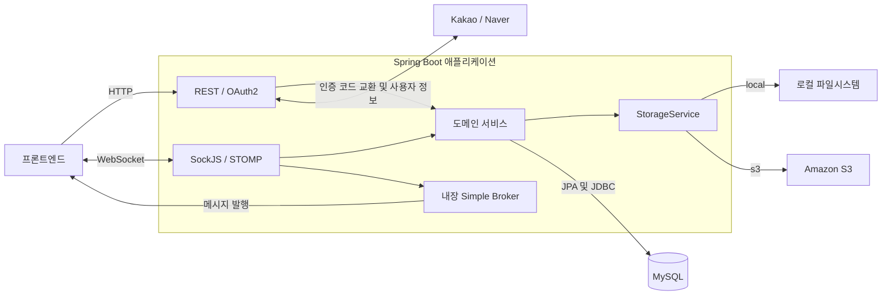
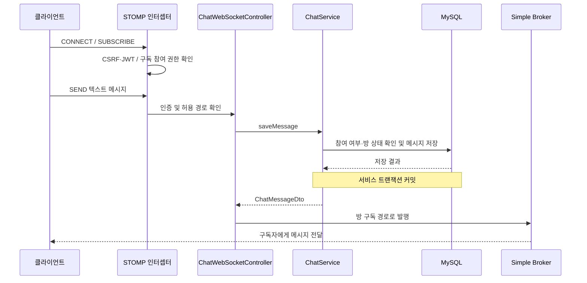

# 아키텍처

프론트엔드와 함께 지키는 계약은 [contracts](contracts/http.md), 파일 저장의 세부는 [파일 저장](storage.md), 실행·배포 절차와 운영 상태는
[실행과 운영](operations.md)을 참고합니다.

## 시스템 개요

백엔드는 Java 17과 Spring Boot를 사용하는 단일 Gradle 애플리케이션입니다. 인증, 사용자, 입양 게시글과 채팅 기능이 같은 프로세스에서 실행되고 MySQL을
공유합니다. 기술 의존성의 정확한 버전은 [build.gradle.kts](../build.gradle.kts)를 기준으로 합니다.

REST는 데이터 조회·변경과 업로드 URL 발급을, STOMP는 실시간 텍스트 메시지 송수신을 담당합니다. 파일 본문은 클라이언트가 저장소에 직접 올리고, DB의
`storage_file` 테이블이 저장 파일명, 원본 파일명 등의 메타데이터와 파일 상태를 보관합니다.

저장소 구현은 `app.storage.type`으로 선택합니다. 저장소에 포함된 `local` 프로필은 로컬 파일시스템을, `prod` 프로필은 S3를 사용합니다.

위 그림은 코드상 연결 가능한 구성 요소를 모두 보여줍니다. 실제로 어떤 구성이 켜져 있는지는 프로필과 설정에 따라 다르며, [실행과 운영](operations.md)을
기준으로 합니다.

## 코드 구조

### 패키지 책임

- `auth`: 로컬 로그인과 가입, OAuth2, JWT, refresh·CSRF·recent-auth 쿠키
- `user`: 사용자, 프로필 이미지, 자격 증명 연결과 계정 관리
- `adoption`: 입양 게시글, 이미지, 댓글과 답글, 입양자 확정
- `chat`: 게시글 기반 채팅방, 참여자, 메시지와 첨부파일
- `storage`: 공통 저장 계약, 로컬 파일시스템/S3 구현, 파일 행(`storage_file`)의 상태 관리, 트랜잭션 이후 파일 삭제와 고아 파일 정리
- `global`: 공통 설정, 검증 정책, 오류 응답과 TSID 변환
- `audit`: 인증, 권한, 삭제 등 주요 행위의 감사 로그

기준 경로는 [`com.sns.marigold`](../src/main/java/com/sns/marigold)입니다. 도메인별 패키지 안에 `controller`,
`service`, `repository`, `entity`, `dto` 등을 배치합니다.

## 핵심 데이터 모델

[Adoption](./erd/adoption.mmd)

- 게시글은 작성자와 연결되고 이미지·댓글을 가집니다. 댓글은 선택적으로 부모 댓글을 참조하며 (대댓글), 대댓글 생성 시 부모가 같은 게시글에 속하는지 검사합니다.
- `AdoptionAdopter`의 `adoption_post_id`에는 유일 제약을 선언합니다. 게시글별 입양자는 최대 한 명입니다
- 게시글 삭제는 `deletedAt`을 기록하는 논리 삭제입니다. 관련 댓글 정리, 채팅방 종료와 파일 삭제 이벤트가 함께 수행되며, 모든 연관 데이터의 물리 삭제를 뜻하지
    않습니다.

[Chat](./erd/chat.mmd)

- `RoomParticipant`의 `(chat_room_id, user_id)`에는 유일 제약을 선언합니다. 서비스는 방을 만들 때 두 사용자를 등록하고 응답 변환 시 참여자
  수가 2명인지 확인하지만, DB 관계 자체가 2명을 강제하지는 않습니다.
- 참여자의 나가기는 행 삭제 대신 `leavedAt`을 기록하고, 재참여 시 이를 지웁니다. 방 종료 상태 `CLOSED`와 개별 사용자의 나가기 상태는 별개입니다.

[Storage](./erd/storage.mmd)

- 파일 메타데이터는 `storage_file`에만 있습니다. 4개 파일 테이블(`user_image`, `adoption_post_image`, `adoption_comment_image`,
  `chat_message_attachments`)은 `storage_file_id`로 참조하며, `uk_*_stored_file` 유일 제약이 한 파일을 두 행이 공유하지 못하게 합니다.

- `AdoptionPost`와 `AdoptionComment`는 `version` 컬럼으로 낙관적 락을 사용합니다. 동시 수정으로 나중 커밋이 실패하면 `409 CONCURRENT_MODIFICATION`을
  반환합니다. JPQL bulk update는 `version`을 올리지 않습니다.

[User](./erd/user.mmd)

## 주요 처리 흐름

### 인증과 권한 검사

OAuth2 요청은 우선순위 1의 `OAuth2SecurityConfig`, 일반 요청은 우선순위 2의 `CommonSecurityConfig`가 처리합니다. 두 체인 모두
HTTP 세션 기반 인증을 사용하지 않습니다.

1. 로컬 로그인은 사용자 조회, 비밀번호와 사용자 상태 확인 후 access·refresh token을 발급합니다. Access token은 본문으로 반환하고
   refresh·CSRF·최근 인증 정보는 쿠키로 발급합니다.
2. 일반 REST 요청은 커스텀 CSRF 필터와 JWT 인증 필터를 거칩니다. JWT 검증 결과로 `CustomPrincipal`을 만들고, Controller의
   `@PreAuthorize`와 Service의 소유자·참여자 검사로 접근을 제한합니다. 일반 보안 체인의 URL 규칙 자체는 `permitAll`이므로 새 API의 권한은
   명시적으로 설정해야 합니다.
3. Refresh 요청은 refresh token을 검증하고 DB에서 현재 사용자 상태와 권한을 다시 읽은 뒤 access·refresh·CSRF token을 재발급합니다.
4. OAuth2 로그인·가입 성공 시 refresh·CSRF·최근 인증 쿠키를 발급하고 프론트엔드로 redirect합니다. 프론트엔드는 refresh API로 access
   token을 얻습니다.
5. 자격 증명 등록과 회원 탈퇴 같은 민감 작업은 `RecentAuthService`로 최근 인증도 검사합니다.

`JwtAuthenticationService`는 access token을 검사할 때 DB를 조회하지 않습니다. 그 결과 생기는 권한 변경의 반영 지연, 헤더·쿠키와 CSRF 적용
조건, 기본 유효시간은 [인증 계약](contracts/auth.md)에 있습니다.

근거: [CommonSecurityConfig](../src/main/java/com/sns/marigold/auth/common/CommonSecurityConfig.java), [AuthService](../src/main/java/com/sns/marigold/auth/common/service/AuthService.java), [JwtAuthenticationService](../src/main/java/com/sns/marigold/auth/common/service/JwtAuthenticationService.java), [OAuth2SuccessHandler](../src/main/java/com/sns/marigold/auth/oauth2/handler/OAuth2SuccessHandler.java).

### 입양 완료와 취소

게시글은 `PROCEEDING`으로 생성됩니다. 일반 모집 상태 변경은 `PROCEEDING`과 `RESERVED` 사이에서 수행하며, `COMPLETED` 전환은 입양 완료
작업을 거쳐야 합니다.

`completeAdoption`은 삭제 여부, 요청자의 작성자 여부, 이미 완료되었는지를 확인하고 입양 대상 사용자를 조회합니다. 이후 게시글을 `COMPLETED`로 변경하고
`AdoptionAdopter`를 같은 `@Transactional` 범위에서 저장합니다. 취소는 삭제되지 않은 글이며 완료 상태에서 작성자만 가능하며 관계를 삭제하고 `PROCEEDING`으로 되돌립니다.

후보는 게시글에 연결된 채팅방의 참여자 중 작성자를 제외한 사용자이며, 방을 나간 참여자도 포함합니다. 완료 메서드는 전달받은 입양자가 이 후보에 포함되는지
쓰기 트랜잭션 안에서 다시 확인합니다.

입양 완료는 채팅방을 종료하지 않습니다. 기존 방은 계속 사용할 수 있고, 완료된 게시글에 새 채팅방을 만드는 요청만 거부합니다.

근거: [AdoptionPostService](../src/main/java/com/sns/marigold/adoption/service/AdoptionPostService.java)
의 `updateRecruitmentStatus`, `getCandidates`, `completeAdoption`, `cancelAdoption`.

### 채팅 저장과 발행

REST는 방 생성·조회, 메시지 이력, 첨부파일 메시지 생성과 다운로드 URL을 담당합니다. 텍스트 메시지는 STOMP로 수신합니다.

단계별 검사(핸드셰이크·CONNECT·SUBSCRIBE·SEND)와 연결 종료 코드는 [실시간 계약](contracts/realtime.md)에 있습니다. 서버 쪽에서는
`WebSocketConfig`의 인바운드 인터셉터가 검사를 맡고, `WebSocketTokenSessions`가 세션별 토큰 만료 종료와 방 나가기 후 연결 종료를 맡습니다.
방 나가기는 `ChatController`가 서비스 트랜잭션 커밋 뒤에 연결을 끊어, 다시 연결한 클라이언트의 구독 검사가 나간 상태를 보게 합니다.

파일 메시지는 REST Controller가 `saveFileMessage`를 호출합니다. 이 메서드는 트랜잭션 밖에서 업로드 토큰을 확정한 뒤 `TransactionTemplate`으로
메시지·첨부 메타데이터를 저장합니다. 서비스 트랜잭션 커밋 후 Controller가 STOMP로 발행하고 HTTP `201`을 반환합니다.

DB 커밋과 STOMP 발행은 원자적이지 않습니다. 현재 발행 경로에는 영속 발행 대기열이나 재시도 처리가 없으므로 커밋 뒤 발행이 실패하면 메시지는 DB에 남지만 실시간 전달은
누락될 수 있습니다. 저장된 내용은 REST 이력 조회로 확인할 수 있습니다.

근거: [WebSocketConfig](../src/main/java/com/sns/marigold/chat/config/WebSocketConfig.java), [WebSocketTokenSessions](../src/main/java/com/sns/marigold/chat/config/WebSocketTokenSessions.java), [ChatWebSocketController](../src/main/java/com/sns/marigold/chat/controller/ChatWebSocketController.java), [ChatController](../src/main/java/com/sns/marigold/chat/controller/ChatController.java), [ChatService](../src/main/java/com/sns/marigold/chat/service/ChatService.java).

### 파일 저장

파일 본문은 서버를 거치지 않고, 파일마다 `storage_file` 행이 `PENDING → ATTACHED → DELETED`로 상태를 바꿉니다. 저장소는 DB 트랜잭션에
참여하지 않으므로 업로드 확정은 트랜잭션 밖에서, 도메인 행 연결은 트랜잭션 안에서 하고, 남은 파일은 고아 정리가 지웁니다. 상태 전이, 트랜잭션 경계,
삭제와 정리의 세부는 [파일 저장](storage.md)에 있습니다.

## 공통 정책과 현재 제약

### 오류, 검증과 식별자

- HTTP 오류는 MVC의 `GlobalExceptionHandler`와 보안 경계의 처리기를 통해 공통 오류 정책과 Problem Details로 변환합니다. STOMP는
  별도의 오류 처리기를 사용합니다. 구체적인 응답 형식은 [HTTP 계약](contracts/http.md)과 [실시간 계약](contracts/realtime.md)을 기준으로 합니다.
- 검증
  상수는 [ValidationPolicy](../src/main/java/com/sns/marigold/global/validation/ValidationPolicy.java)를
  기준으로 관리합니다. DTO·Entity·파일 검증에서 사용하며, JSON 생성·검증 절차는 [README](../README.md)에 있습니다.
- TSID를 사용하는 ID는 내부 `Long`과 외부 문자열 표현을 구분합니다. DTO의 `@TsidId`, 경로 변수의 `TsidValue`, `TsidCodec`이 변환을
  담당합니다. 모든 `Long` ID에 일괄 적용되는 규칙은 아니므로 API별 DTO와 Controller를 확인해야 합니다.
- `RequestIdFilter`는 요청 식별자를 응답과 로그에 연결합니다. `AuditLogger`는 별도의 `audit` 로거에 주요 행위를 기록하며, DB 감사 테이블이나
  커밋 완료를 보장하는 이벤트 저장소는 아닙니다.

근거: [오류 처리](../src/main/java/com/sns/marigold/global/error), [TSID 변환](../src/main/java/com/sns/marigold/global/tsid), [AuditLogger](../src/main/java/com/sns/marigold/audit/AuditLogger.java).

### 재시작과 다중 서버

현재 구현에서 다음 상태는 애플리케이션 프로세스에 속합니다.

- 내장 STOMP Simple Broker와 WebSocket 세션은 서버 간 공유되지 않습니다. 다중 서버에서는 한 서버의 발행이 다른 서버의 구독자에게 전달되도록 별도 구성이
  필요합니다.
- [WebSocketTokenSessions](../src/main/java/com/sns/marigold/chat/config/WebSocketTokenSessions.java)의 세션 목록과
  만료 종료 예약도 인스턴스마다 따로 있습니다. 방 나가기는 요청을 받은 서버의 연결만 끊으므로, 다른 서버에 붙은 연결은 access token 만료로 끊길
  때까지 그 방의 메시지를 계속 받습니다.
- [InMemoryRecentAuthStore](../src/main/java/com/sns/marigold/auth/common/recent/InMemoryRecentAuthStore.java)
  의 최근 인증 정보는 재시작하면 사라집니다. 다른 인스턴스에도 공유되지 않아 해당 인스턴스가 발급한 최근 인증을 다른 서버가 확인할 수 없습니다.
- 파일 삭제 이벤트·비동기 큐는 재시작 후 재생되지 않고, 고아 파일 정리의 실행 잠금도 인스턴스 간 조율을 제공하지 않습니다.
- 로컬 파일시스템 저장소를 사용하면 파일 접근 범위도 서버의 디스크 구성에 의존합니다.

따라서 HTTP 세션을 사용하지 않는다는 설정만으로 다중 서버 동작이 보장되지는 않습니다. 서버를 늘릴 때 메시지 전달, 최근 인증 상태, 파일 접근과 정리 작업의 실행 주체를
함께 검토해야 합니다.

### 변경 시 확인할 테스트

- [AdoptionPostServiceTest](../src/test/unit/java/com/sns/marigold/adoption/service/AdoptionPostServiceTest.java):
  작성자 권한, 일반 상태 변경의 완료 전환 거부, 입양 취소, 업로드 확정 실패와 저장 실패 시 처리.
- [WebSocketConfigTest](../src/test/unit/java/com/sns/marigold/chat/config/WebSocketConfigTest.java),
  [WebSocketTokenSessionsTest](../src/test/unit/java/com/sns/marigold/chat/config/WebSocketTokenSessionsTest.java):
  STOMP 단계별 검사, 토큰 만료와 방 나가기에 따른 연결 종료.
- [ChatIntegrationTest](../src/test/integration/java/com/sns/marigold/chat/api/ChatIntegrationTest.java):
  실제 애플리케이션과 DB를 사용하는 채팅 동작.

파일 저장 관련 테스트는 [파일 저장](storage.md#변경-시-확인할-테스트)에 있습니다. 테스트 실행 명령과 종류별 범위는 [README](../README.md)의 검사
항목을 참고합니다.
