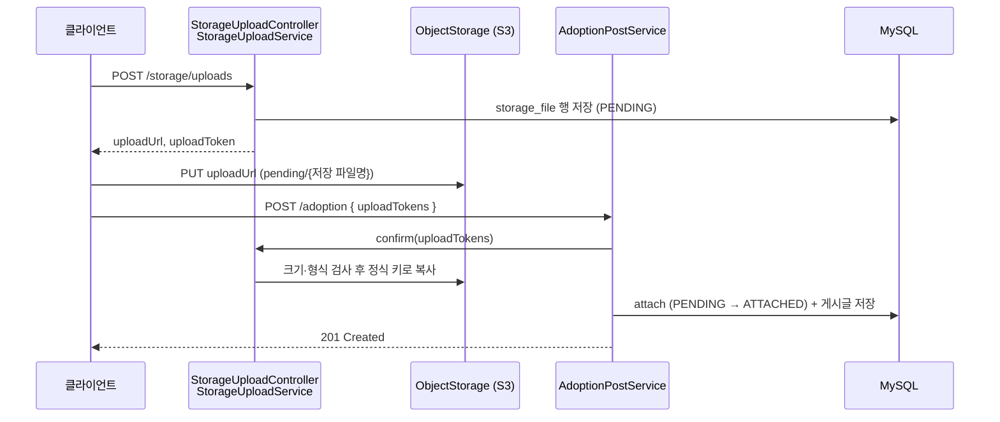

# 파일 저장

파일 본문을 저장소에 직접 올린 뒤 도메인 행에 연결하는 과정, 그 과정의 트랜잭션 경계와 고아 파일 정리를 설명합니다. 클라이언트가 지키는 업로드 절차는 [업로드 계약](contracts/uploads.md)에 있습니다.

## 파일 상태와 저장 위치

파일 본문은 서버를 거치지 않습니다. 파일마다 `storage_file` 행이 하나 있고, 상태에 따라 저장 위치가 다릅니다.

| 상태 | 언제 | 저장 위치 |
|------|------|-----------|
| `PENDING` | `POST /storage/uploads`로 URL을 발급할 때 | 클라이언트가 `pending/{저장 파일명}`에 직접 `PUT` |
| `ATTACHED` | 도메인 저장 트랜잭션이 행을 참조할 때 | 확정 단계가 정식 키 `{저장 파일명}`으로 옮김 |
| `DELETED` | 교체·삭제로 더 참조하지 않을 때 | 커밋 후 저장소에서 삭제. 행은 이력으로 남음 |

`pending/`은 확정 전 파일만 두는 임시 영역입니다. 운영 S3는 이 prefix에 Lifecycle 만료 규칙을 걸어, 등록되지 않은 업로드를 저장소가 직접
지우게 합니다. 규칙은 [실행과 운영](operations.md#s3-임시-영역-pending)에 있습니다. 로컬 저장소는 같은 경로 구조를 쓰고 고아 정리가 지웁니다.

## 전체 흐름

도메인 API가 받는 `UploadToken`은 클라이언트가 그보다 먼저 발급받아 파일을 올린 결과입니다. 백엔드 코드만 보면 발급 단계가 보이지 않으므로,
게시글 생성을 예로 순서를 정리합니다. 댓글·채팅 첨부·프로필도 같은 순서입니다.

## 저장소 계약과 트랜잭션 경계

도메인 서비스는 다음 순서로 파일을 연결합니다.

1. **확정 (트랜잭션 밖)**: `StorageUploadService.confirm`이 토큰을 검증하고, `pending/` 파일의 실제 크기와 앞 64KB로 감지한 형식을 검사한 뒤
   정식 키로 옮깁니다. 하나라도 검사에 실패하면 아무것도 옮기지 않습니다. 정식 키에 이미 있는 파일은 확정을 마친 것으로 보고 검사와 이동을
   건너뜁니다. S3 업로드 URL은 내용을 서명하지 않아 확정 도중에도 `pending/` 파일을 바꿀 수 있으므로, 크기를 읽을 때 받은 ETag를 조건으로
   앞부분을 읽고(`If-Match`) 복사합니다(`x-amz-copy-source-if-match`). 그 사이 파일이 바뀌면 S3가 `412`로 거부하고 확정은
   `UPLOAD_INCOMPLETE`로 실패합니다. 로컬 저장소는 있는 `pending/` 파일을 덮어쓰지 않아 버전을 확인하지 않습니다.
2. **연결 (트랜잭션 안)**: `StorageFileService.attach`가 `PENDING → ATTACHED`로 바꾸고, 도메인 행은 그 `StorageFile`을 FK로 참조합니다.
   이미 쓴 업로드가 섞여 있으면 `409 UPLOAD_ALREADY_USED`로 트랜잭션 전체가 롤백됩니다.

업로드 토큰은 저장 파일명, 업로더, 용도, 크기, 만료 시각을 HMAC으로 서명한 값입니다. 다른 사용자의 파일이나 임의의 저장 키를 도메인에 연결하지 못하게
하는 것이 토큰의 역할입니다.

파일 저장소는 MySQL 트랜잭션에 참여하지 않습니다. 그래서 확정을 DB 트랜잭션보다 먼저 실행하고, 이후 어느 단계에서 실패해도 행이 `PENDING`으로
남게 합니다. 서비스는 새 파일을 직접 지우지 않고 고아 정리에 맡깁니다. DB가 없는 파일을 가리키는 상태는 생기지 않습니다. 확정 뒤 저장이 실패해도
토큰이 유효한 동안 같은 토큰으로 다시 보낼 수 있습니다. 확정 단계가 정식 키를 먼저 확인하므로, 업로드 URL로 `pending/`에 다시 올린 파일이
이미 확정된 파일을 덮어쓰지 못합니다.

| 호출 경로                   | 확정과 DB 트랜잭션                                                                         |
|-------------------------|-------------------------------------------------------------------------------------|
| 게시글 생성·수정, 댓글 생성·수정    | 트랜잭션 밖에서 확정 후 `TransactionTemplate` 안에서 `attach`와 DB 변경                                  |
| 프로필 변경 `updateUser`     | 트랜잭션 밖에서 확정 후 `TransactionTemplate` 안에서 `attach`와 DB 변경                                  |
| 채팅 첨부 `saveFileMessage` | 클래스 기본 트랜잭션을 `NOT_SUPPORTED`로 끄고, 권한 사전 검사 → 확정 → `TransactionTemplate` 안에서 `attach`와 메시지 저장 |

확정은 파일마다 저장소에 요청을 보내므로, 그동안 DB 커넥션을 점유하지 않도록 트랜잭션 밖에서 실행합니다. 이를 위해 OSIV(`spring.jpa.open-in-view`)를 꺼서
커넥션을 트랜잭션 동안만 사용합니다. 트랜잭션 밖에서 읽은 엔티티는 지연 로딩할 수 없으므로 사전 검사도 트랜잭션 안에서 하고, 저장 트랜잭션에서 다시 조회해
확정하는 동안 생긴 변경(예: 게시글 삭제)을 다시 검사합니다. 파일 테이블의 `getStoredFileName()` 등은 지연 로딩되는 `storage_file`을 읽으므로
역시 트랜잭션 안에서만 호출합니다.

업로드 토큰 유효시간(`app.storage.upload.token-ttl`, 기본 1시간)은 고아 정리 `minimum-age`보다 짧아야 합니다. 어긋나면 고아 정리가 아직 쓸 수
있는 토큰의 `PENDING`을 만료시켜 파일을 지운 뒤, 그 파일을 가리키는 행이 커밋될 수 있어 앱이 기동 시 이 관계를 검사하고 시작을 거부합니다.

## 커밋·롤백 이후 파일 삭제

- 확정했지만 커밋되지 않은 새 파일은 삭제하지 않고 고아 정리에 맡깁니다. 사용자가 파일을 올린 뒤 등록하지 않은 경우도 같습니다.
- 교체·제거한 기존 파일은 `DeleteOldStorageFilesEvent`를 등록합니다. 동기 리스너가 같은 트랜잭션에서 행을 `ATTACHED → DELETED`로 바꾸고,
  `AFTER_COMMIT` 리스너가 저장소 삭제를 시도합니다. 도메인 서비스는 이벤트만 발행하면 됩니다.

삭제 리스너는 `storageTaskExecutor`를 사용하는 비동기 작업입니다. 다만 실행기와 큐가 포화되면 `CallerRunsPolicy`에 따라 호출 스레드에서
실행될 수 있습니다.

삭제는 `best-effort`입니다. 삭제 실패는 로그로 남기며 이미 커밋된 DB 변경을 되돌리지 않습니다. 이벤트와 실행기 큐는 영속 저장되지 않지만, 행이
`DELETED`로 남으므로 남은 파일은 고아 정리의 저장소 스캔이 지웁니다.

근거: [StorageUploadService](../src/main/java/com/sns/marigold/storage/service/StorageUploadService.java), [StorageFileService](../src/main/java/com/sns/marigold/storage/service/StorageFileService.java), [UploadTokenCodec](../src/main/java/com/sns/marigold/storage/service/UploadTokenCodec.java), [StorageEventListener](../src/main/java/com/sns/marigold/storage/event/StorageEventListener.java), [StorageTaskExecutorConfig](../src/main/java/com/sns/marigold/storage/config/StorageTaskExecutorConfig.java).

## 고아 파일 정리

`StorageOrphanCleanupService`는 한 번 실행할 때 두 단계를 거칩니다.

1. **만료된 PENDING 정리 (주 경로)**: `created_at`이 `minimumAge`보다 오래된 `PENDING` 행을 1,000개씩 읽어, `pending/`과 정식 키의
   파일을 지우고 `DELETED`로 바꿉니다. 토큰 TTL이 `minimumAge`보다 짧으므로 이 행들은 더 확정될 수 없습니다. 파일을 먼저 지우므로 상태 변경이
   실패해도 다음 실행이 다시 처리합니다.
2. **저장소 스캔 (안전망)**: 저장소 목록을 1,000개 이하의 페이지로 받아, `PENDING`·`ATTACHED` 행이 없고 마지막 수정 시각이 `minimumAge`보다
   오래된 파일을 지웁니다. 커밋 후 삭제에 실패한 `DELETED` 파일이 여기서 지워집니다. `pending/` 키는 저장 파일명 형식이 아니라서 스캔에서
   빠집니다.

참조 여부는 `storage_file` 한 테이블만 봅니다. 파일을 저장하는 도메인 테이블을 추가해도 `storage_file`을 FK로 참조하면 정리 쿼리는 바꾸지
않습니다. 메모리에는 한 페이지와 로그 샘플만 남으므로 사용량이 전체 파일 수와 무관합니다. 실행 중 실패하면 앞 페이지의 후보는 이미 삭제됐을 수
있습니다.

실행 방식은 `off`, `startup`, `scheduled`, `both`이며 `dryRun=true`이면 두 단계 모두 후보만 기록합니다. 코드 기본값은 `mode=off`, `dry-run=true`이고,
현재 프로필 설정은 다음과 같습니다.

- `local`: 시작 시 실행, `minimum-age=24h`, `dry-run=false`
- `prod`: 매일 04:00(Asia/Seoul) 예약 실행, `minimum-age=24h`, `dry-run=false`

클라이언트 직접 업로드에서는 이 작업이 로컬 저장소의 새 파일을 지우는 유일한 수단이고, 운영에서는 `pending/`
Lifecycle 규칙과 함께 동작합니다.

이 작업은 `ATTACHED` 파일을 정리하지 않습니다. 실행 중복 방지는 프로세스 내부 `AtomicBoolean`으로만 이루어집니다.

> [!WARNING]
> `storage_file` 행이 없는 파일은 저장소 스캔이 고아로 봅니다. 기존 데이터가 있는 DB는
> [storage_file 마이그레이션](migrations/2026-10-25-storage-file.md)으로 행을 백필한 뒤에 정리 작업을 켜야 합니다.

근거: [StorageOrphanCleanupService](../src/main/java/com/sns/marigold/storage/cleanup/StorageOrphanCleanupService.java), [StorageFileReferenceRepository](../src/main/java/com/sns/marigold/storage/cleanup/StorageFileReferenceRepository.java), [StorageCleanupProperties](../src/main/java/com/sns/marigold/storage/cleanup/StorageCleanupProperties.java).

## 변경 시 확인할 테스트

- [StorageUploadServiceTest](../src/test/unit/java/com/sns/marigold/storage/service/StorageUploadServiceTest.java):
  토큰 위조·만료·업로더·용도 불일치, 크기와 형식 검사, 이미 확정한 파일을 건너뛰는 재시도.
- [StorageFileServiceTest](../src/test/unit/java/com/sns/marigold/storage/service/StorageFileServiceTest.java):
  PENDING이 아닌 업로드를 연결하면 `UPLOAD_ALREADY_USED`, 상태 전이 조건.
- [StorageEventListenerTest](../src/test/component/java/com/sns/marigold/storage/event/StorageEventListenerTest.java):
  커밋·롤백, 외부 트랜잭션 롤백과 커밋 직전 실패에 따른 파일 정리.
- [StorageOrphanCleanupServiceTest](../src/test/unit/java/com/sns/marigold/storage/cleanup/StorageOrphanCleanupServiceTest.java):
  만료된 PENDING 정리, 참조 여부·파일 나이·dry-run에 따른 정리 대상, 페이지 단위 조회와 삭제.
